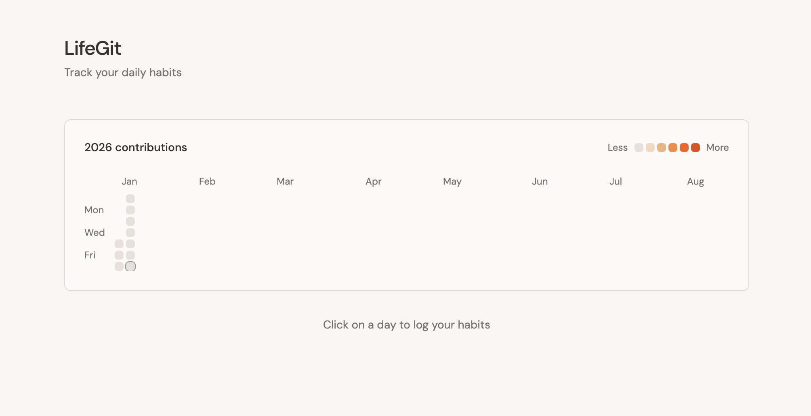

<div align="center">

  <h1>GitLife </h1>

  <p>
    <strong>Commit to a better version of yourself.</strong>
  </p>

  <p>
    <a href="#-the-concept">The Concept</a> •
    <a href="#-how-it-works">How It Works</a> •
    <a href="#-the-algorithm">The Algorithm</a> •
    <a href="#️-getting-started">Getting Started</a> •
    <a href="#-contributing">Contributing</a> •
  </p>


</div>

<br />

<p align="center">
  
</p>

<br />

## 🚀 The Concept

As developers, we are obsessed with keeping our GitHub contribution graph populated. We hate breaking streaks. **GitLife** applies that same psychological "streak" mechanic to your physical and mental health.

Instead of the standard GitHub Green, GitLife uses a **Burning Orange** heatmap to represent your daily intensity.

> "You wouldn't leave your main branch unmaintained. Don't do it to your body."

## 🕹 How It Works

Every day, you create a **"Commit"** by logging three core metrics. Instead of lines of code, you are measuring effort on a scale of **1 to 5**:

1.  💪 **Workout:** Did you move your body? (Intensity/Duration)
2.  🥗 **Nutrition:** Did you eat clean? (Quality/Adherence)
3.  📚 **Reading:** Did you expand your mind? (Pages/Time)

## 📊 The Algorithm

The app calculates a **Daily Commit Score** (Total: 0–15) to determine the color intensity of that day's square on your calendar.

$$Score = Workout_{(1-5)} + Nutrition_{(1-5)} + Reading_{(1-5)}$$

## 🛠️ Getting Started

### Prerequisites

- Node.js (v18 or higher recommended)
- bun package manager
- Supabase account (for authentication)

### Installation

1. Clone the repository:

   ```bash
   git clone https://github.com/yourusername/GitLife.git
   cd GitLife
   ```

2. Install dependencies:

   ```bash
   bun install
   ```

3. Set up Supabase:

- Create a new project on [Supabase](https://supabase.com/)
- Copy your Supabase URL and Anon Key
- Create a `.env` file from the template:

  ```bash
  cp .env.template .env
  ```

- Edit the `.env` file with your Supabase credentials:

  ```env
  VITE_SUPABASE_URL=your-supabase-project-url
  VITE_SUPABASE_ANON_KEY=your-supabase-anon-key
  ```

4. Enable Email/Password authentication in Supabase:
   - Go to your Supabase project dashboard
   - Navigate to Authentication → Providers
   - Enable Email/Password authentication
   - Configure your SMTP settings for email verification

### Running the App

Start the development server:

```bash
bun run dev
```

The app will be available at `http://localhost:5173` (or another port if 5173 is in use).

### Other Available Commands

- `bun run build` - Build for production
- `bun run build:dev` - Build for development
- `bun run preview` - Preview the production build
- `bun run lint` - Run the linter
- `bun run format:check` - Check code formatting
- `bun run format:write` - Apply code formatting
- `bun run ts:check` - Run TypeScript type checks

### macOS desktop app

GitLife also runs in a native macOS window, following PhDHome's AppKit/WebKit
approach. It bundles the existing habits, goals, bookshelf, and blog interface;
no development server or Node.js process is needed when opening the app.

On macOS 12 or later, install Xcode command-line tools (`xcode-select --install`),
Python 3.9 or later, and the web dependencies above. Configure `.env` with your
Supabase project, then build and install:

```bash
npm run desktop:install
open /Applications/GitLife.app
```

`npm run desktop:build` only creates `build/GitLife.app`.
`npm run desktop:test` checks SPA routing, static assets, and server boundaries.
Rebuild and reinstall to include source or `.env` changes.

The app serves its bundled files only at `http://127.0.0.1:47831`. Keep this port
available; its stable address preserves login and dashboard preferences across
launches. WebKit stores these separately from your browser, so sign in once in the
desktop app. Existing account data stays in Supabase and requires internet access.
External links open in your default browser. Logs are in
`~/Library/Application Support/GitLife/desktop.log`.

The app uses the Python interpreter selected during the build; keep that Python
installation available. Builds are signed locally for this Mac, without Apple
notarization or an automatic updater. Only the built frontend and static server
are bundled; `.env` is not copied. Vite embeds public `VITE_` values in frontend
assets, so use a Supabase publishable/anon key, never a service-role key.

Email confirmation and password recovery keep the web app's existing behavior.
Supabase redirect configuration must allow the desktop origin if you use email
links. The repository currently lacks a `/reset-password` page, so password
recovery completion needs to be handled on your configured website.

### MCP server (connect LLM clients)

`mcp/server.ts` is a standard [MCP](https://modelcontextprotocol.io) server
over stdio, so any MCP-capable LLM client (e.g. InstinctAI, Claude Desktop) can
read and update your GitLife data. It signs in as you with email/password, so
Supabase Row Level Security applies; never give it a service-role key.

Required env vars (read from the repo `.env`, or set in the client config):
`VITE_SUPABASE_URL`, `VITE_SUPABASE_ANON_KEY`, `GITLIFE_EMAIL`, `GITLIFE_PASSWORD`.

Tools: `list_habits`, `get_contributions`, `log_habit`, `unlog_habit`,
`list_goals`, `list_books`, `list_blogs`.

Run it manually with `bun run mcp`. To attach a client, add to its MCP config
(`--cwd` makes bun load the repo `.env`; the `env` block is optional if `.env`
is filled in):

```json
{
  "mcpServers": {
    "gitlife": {
      "command": "bun",
      "args": ["--cwd", "/abs/path/GitLife", "mcp/server.ts"],
      "env": {
        "GITLIFE_EMAIL": "you@example.com",
        "GITLIFE_PASSWORD": "your-password"
      }
    }
  }
}
```

## 🤝 Contributing

Contributions are always welcome! Please create a PR to merge your changes.

1.  Fork the Project
2.  Open issue
3.  Create your Feature Branch from the issue (`git checkout -b feature/AmazingFeature`)
4.  Commit your Changes (`git commit -m 'Add some AmazingFeature'`)
5.  Push to the Branch (`git push origin feature/AmazingFeature`)
6.  Open a Pull Request and assign 2 reviewer

## 📄 License

Distributed under the MIT License. See `LICENSE` for more information.
